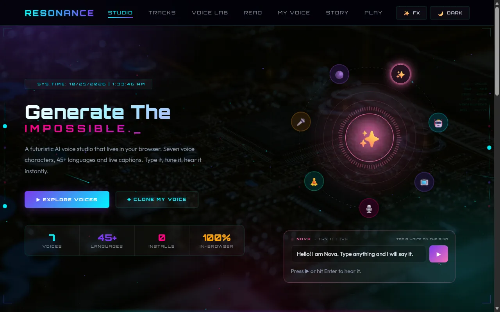
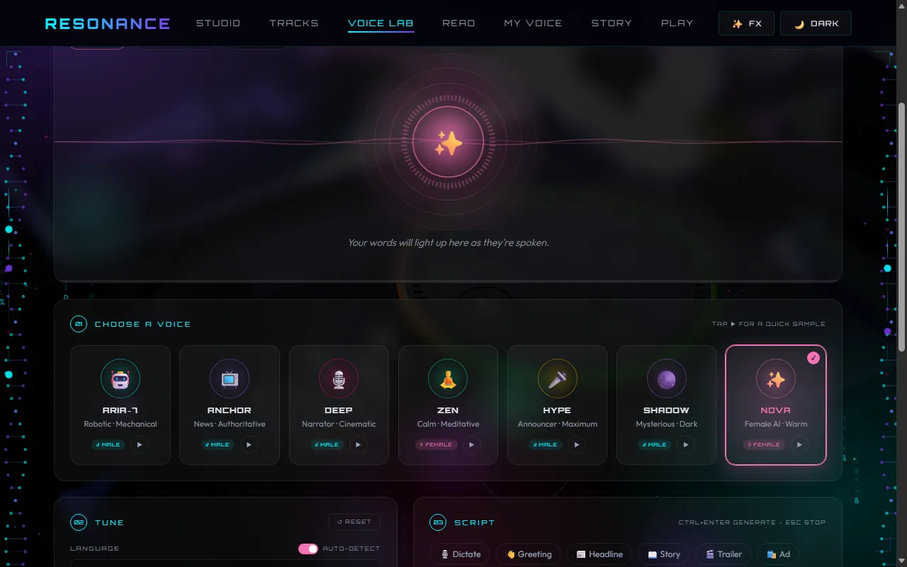
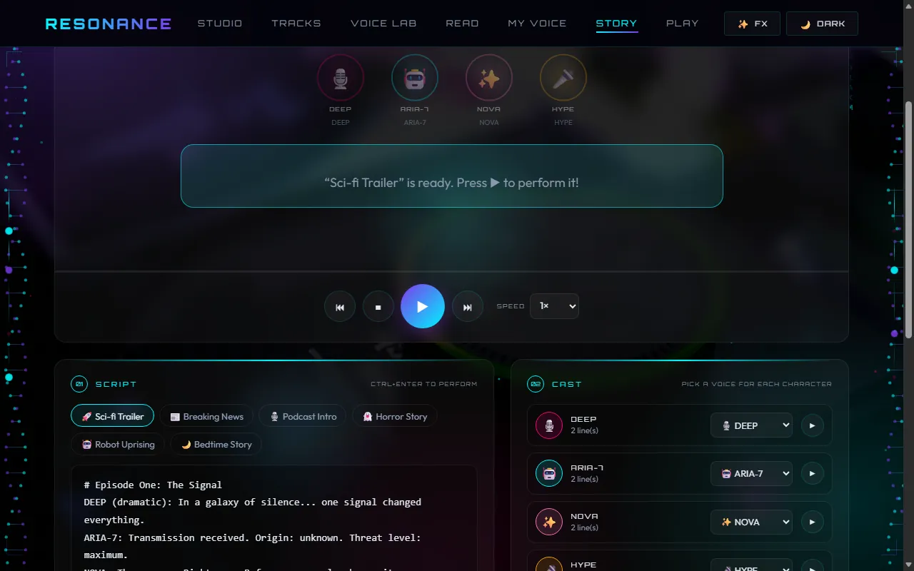
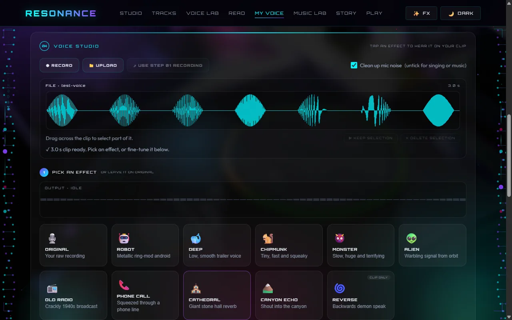
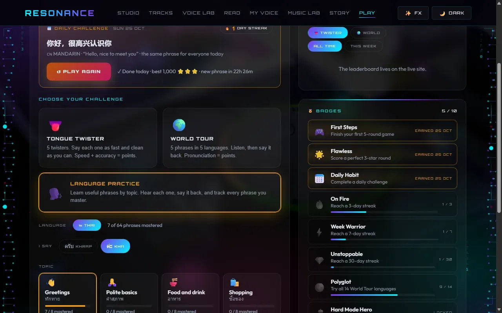
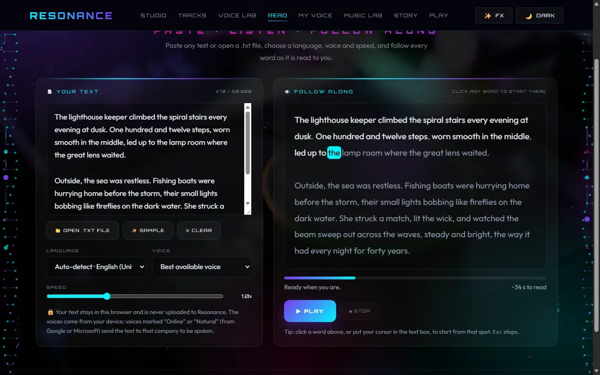
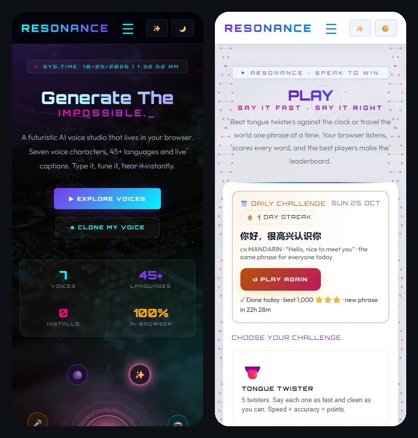
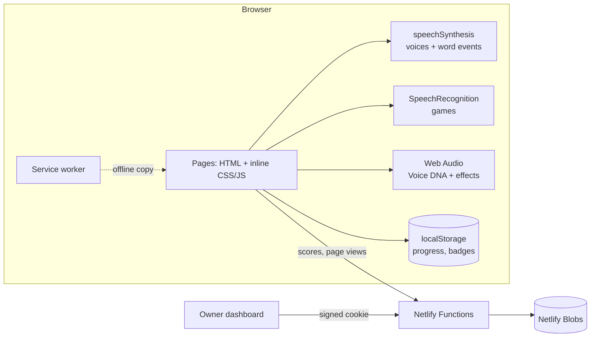

<div align="center">

# 🎙️ RESONANCE

### ✨ AI Audio Studio — Text-to-Speech in Your Browser ✨

Type any text, pick a voice, set the mood, and hear it come alive instantly. 🔊


**[▶ Open the live site](https://resonancesun.netlify.app)**

[📸 Screenshots](#-screenshots) • [🚀 Features](#-features) • [🧠 How it works](#-how-it-works) • [⚡ Performance](#-performance--lighthouse) • [💡 What I learned](#-what-i-learned) • [⚙️ Getting Started](#️-getting-started) • [🔌 API](#-api)

</div>

---

## 📖 About

**RESONANCE** is a futuristic voice studio that runs in the browser. Type any text, choose a voice character, language, emotion, speed and pitch, and hear it spoken in real time using the **Web Speech API**. It also reads whole documents aloud, performs multi-voice stories, measures your own voice, and turns speaking into games: tongue twisters, a world tour of languages and Thai phrase practice, with a leaderboard and challenge links you can send to a friend. 😎

Everything is built with plain HTML, CSS and JavaScript, no framework and no paid services: browser APIs do the audio, and a few small Netlify Functions handle the leaderboard and the owner dashboard.

---

## 📸 Screenshots

| | |
| --- | --- |
|  |  |
| **Studio**: talk through the voice orb | **Voice Lab**: 7 characters, 45+ languages, emotions |
|  |  |
| **Story Studio**: a script performed by several voices | **My Voice**: Voice DNA and live voice changer |
|  |  |
| **Play**: tongue twisters, World Tour, Thai practice | **Reader**: any text read aloud, word by word |

<p align="center"></p>

---

## 🚀 Features

### 🎛️ Voice Lab
Real-time speech synthesis with live controls:

| Option | Choices |
| --- | --- |
| 🗣️ **Voice characters** | Nova, Aria‑7, Anchor, Deep, Zen, Hype, Shadow — each with its own color theme |
| 🚻 **Gender** | Male, Female |
| 🌍 **Languages** | 45+ built in (Thai, Japanese, Korean, Chinese, Hindi, Sinhala, Tamil, Arabic, Spanish, French, German and more), plus every extra language your device has voices for |
| 🔍 **Auto-detect** | Type in Thai, Japanese, Korean, Arabic, Hindi, Russian and other scripts and the language switches automatically |
| 🎧 **Device voice picker** | Picks the best natural voice for the character's gender automatically, or choose any installed voice yourself |
| 🎭 **Emotions** | Neutral, Calm, Energetic, Formal, Dramatic, Mysterious |
| 🎚️ **Fine-tuning** | Speed, pitch and volume sliders |

### 🌟 Live Stage
- 🔮 **Animated visualizer** — a glowing orb and waveform that pulse with every spoken word
- 📝 **Live captions** — each word lights up as it's spoken, with a progress bar and timer
- ⏯️ **Pause, resume and stop** — plus `Ctrl + Enter` to generate and `Esc` to stop
- ✍️ **Script templates** — greeting, headline, story, trailer, ad and *Surprise me*
- 🕘 **Recent takes** — replay your last 8 generations with their exact settings
- 🔗 **Share a take** — copy a link that opens the lab with your voice, settings and text

### 🧬 My Voice — Clone Studio
- 🎙️ **Record or upload** — up to 15 seconds from your mic (with a line to read aloud) or any audio file
- 🧬 **Voice DNA** — measures your pitch, range, pace, energy and brightness, drawn as a radar chart
- 🏆 **Voice twin** — ranks how closely you match each of the 7 Resonance characters
- 🗣️ **Speak as me** — tunes a browser voice to your pitch and pace so it can say anything you type
- 🎛️ **Voice changer** — Robot, Deep, Chipmunk, Monster, Alien, Old Radio, Phone, Cathedral, Canyon Echo and Reverse, with WAV download
- 🎧 **Live mic** — every effect except Reverse works in real time (Deep, Chipmunk and Monster use a live pitch shifter), and ⏺ **Record take** saves your transformed voice as a WAV you can play back and download
- 🔒 **Private** — your recording is processed in the browser and never uploaded

### 📲 App, Speed & Polish
- 📲 **Installable app (PWA)** — add Resonance to your home screen or desktop; pages keep working offline
- ⚡ **Performance mode** — heavy background effects switch to *lite* automatically on slower devices (or tap ✨ FX / ⚡ LITE in the menu)
- ♿ **Accessible** — keyboard focus outlines, screen-reader labels, skip link, readable contrast and reduced-motion support (see [Lighthouse scores](#-performance--lighthouse))
- 🔗 **Link previews** — share any page and it shows a proper image and description

### 🎭 Story Studio (`/story.html`)
- ✍️ **Write any script**: `NOVA: Hello!`, `DEEP (dramatic): In a world...`, `[pause 2]`, `# Scene title`. Use any character names you like
- 🎬 **Auto-casting**: every character gets a voice (change it anytime), plus 6 ready-made stories
- 🗣️ **Live performance**: talking avatars, a speech bubble that follows the speaker, word-by-word captions, moods, speed control
- ⏯️ **Scene list**: tap any line to start from there · 🔗 share links · ⬇ download the script

### 🎮 Play: Speak to Win (`/play.html`)
- 👅 **Tongue Twister**: 5 rounds in Easy / Medium / Hard, scored on accuracy and speed with live word-by-word feedback
- 🌍 **World Tour**: hear a phrase in one of 14 languages, say it back, get scored on pronunciation
- 🗣️ **Language Practice**: 64 everyday Thai phrases in 8 topics (greetings, food, shopping, getting around…). Each phrase plays first, with a pronunciation guide, a slower replay and the meaning; say it back and it's scored like World Tour. Choose the ครับ (khrap) or ค่ะ (kha) polite ending. Your best score per phrase is saved in the browser, topics show what you've mastered, and you can replay just the tricky ones. More languages can be added in `phrases.js`
- ⚔️ **Pass & play**: two players, one device. Take turns on the same tongue twisters, hand the phone over between turns, and see round-by-round scores on the winner screen (stays on the device, not sent to the leaderboard)
- 🔗 **Challenge a friend**: after a solo tongue twister game, get a link with your name, your five twisters and your scores. Your friend plays the same twisters and sees a head-to-head result, then can challenge you back. No account or server needed: everything is in the link
- 🏆 **Live leaderboard**: all-time and weekly boards, with medals, confetti and share-your-score
- 🎙️ Uses your browser's speech recognition (Chrome, Edge or Safari)

### 📖 Reader (`/read.html`)
- 📄 **Any text**: paste it, type it, or open / drop a `.txt` file (UTF-8, UTF-16 or Windows-1252, up to 50,000 characters, about an hour of listening)
- 🌍 **Language, voice and speed**: auto-detects the script (Thai, Japanese, Arabic…) or pick any language your device has a voice for
- ✨ **Live word highlighting** that follows along and scrolls with the voice, including languages without spaces such as Thai and Japanese
- ⏯️ **Play, pause, resume and stop**; click any word (or put your cursor in the text) to start from there
- 🔒 Your text and settings stay in this browser

### 🎙️ Dictation
- The Voice Lab has a **🎙️ Dictate** button: speak instead of typing, then let any character say it back

### 🔐 Owner Dashboard (`/admin.html`)
- 🔑 **Owner-only login** — one password stored as a Netlify environment variable, never in the code
- 📊 **Live stats** — generations, page views, Voice DNA scans and producers, with ▲▼ vs the previous period
- 📈 **Charts** — daily generations & views, top voices, languages, emotions, pages, voice twins and visitor countries
- 🎮 **Play & leaderboard**: games and stories counted; remove rude names or suspicious scores in one click
- 🗂️ **Requests table** — search, filter, sort, expand, **▶ replay in the original voice**, delete, export to CSV
- 🕵️ **Privacy-friendly** — page views are anonymous counts; IPs are never stored (only a salted hash for rate limits)

### 🎵 More
- 🏠 **Interactive home** — a voice orb you can talk through, typewriter headline, clickable world greetings, spotlight cards and scroll animations
- 🎧 **Voice archive** — search, mood filters and ♥ favorites, word-by-word captions, reactive visualizers and 📻 radio mode that plays every voice
- 💾 **Save requests** — Voice Lab submissions are stored in MySQL through a PHP endpoint
- 🛠️ **Admin panel** — view, filter, paginate and delete saved requests, with summary stats
- 🌌 **Futuristic UI** — Orbitron & Outfit fonts with a fully responsive layout

---

## 📄 Pages

| File | Page | Description |
| --- | --- | --- |
| 🏠 `index.html` | Studio | Interactive home: try any voice on the orbiting voice ring, click greetings in 22 languages |
| 🎧 `services.html` | Tracks | Voice archive with search, filters, favorites, live captions and radio mode |
| 🎭 `story.html` | Story | Multi-voice story and podcast performer |
| 🎮 `play.html` | Play | Tongue Twister, World Tour, Language Practice, pass & play and challenge links + leaderboard |
| 🧬 `clone.html` | My Voice | Record your voice, see your Voice DNA, hear a clone of you and try 11 voice-changer effects live or on a recording |
| 🎙️ `contact.html` | Voice Lab | Text-to-speech generator and request form |
| 📖 `read.html` | Reader | Read any pasted text or .txt file aloud with live word highlighting |
| 🛠️ `admin.php` | Admin Panel | Manage saved voice requests *(requires PHP + MySQL)* |

---

## 🧰 Tech Stack

| Layer | Technology |
| --- | --- |
| 🎨 Frontend | HTML5, CSS3, vanilla JavaScript (no framework, no build step), Canvas 2D |
| 🔊 Audio | Web Speech API (`speechSynthesis` and `SpeechRecognition`), Web Audio API, MediaRecorder |
| 🌏 Text | `Intl.Segmenter` for languages without spaces (Thai, Japanese, Chinese) |
| 📴 Offline | Service worker, web app manifest |
| ⚙️ Backend | Netlify Functions (Node.js) · legacy PHP version for XAMPP |
| 🗄️ Storage | Netlify Blobs · `localStorage` for progress · legacy MySQL / MariaDB |
| 🔐 Admin | Password login, signed HttpOnly session cookie, lockout after 5 tries |
| 🧪 Testing | Node's built-in test runner (`node --test`), Lighthouse |
| ☁️ Hosting | Netlify free plan |

---

## 🧠 How it works



- **Speaking**: every voice is the browser's own `speechSynthesis`. A character is a recipe (gender, pitch, rate and a preferred device voice) and emotions nudge pitch and speed. Live captions follow the voice's word-boundary events; when a voice doesn't send them, the page estimates where it is from the speaking rate.
- **Reading long text**: the Reader splits text into sentences and words (with `Intl.Segmenter` for Thai, Japanese and Chinese), speaks it in chunks, and highlights the word under each boundary event. Chrome's Google voices stop after about 15 seconds, so a keep-alive gently pauses and resumes them.
- **Scoring speech**: games listen with `SpeechRecognition`, then compare what you said with the target using an edit distance. For space-separated languages it counts whole words; for Thai, Japanese, Chinese, Korean and similar scripts it counts characters. Tongue twister points reward accuracy and speed: `1000 × accuracy² × (0.6 + 0.4 × speed) × difficulty` (×1, ×1.25 or ×1.5).
- **Voice DNA**: your recording is analysed in the browser. Pitch uses the YIN algorithm on a downsampled copy, pace counts syllable-like peaks in the loudness, and brightness uses the zero-crossing rate while you're speaking. Nothing is uploaded.
- **Challenge links**: the challenger's name, twister numbers and scores are packed into the part of the link after `#`, which browsers never send to a server. A checksum of the twister texts spots links made before the list changed, and the name goes through the same word filter as the leaderboard.
- **Backend**: small Netlify Functions store the leaderboard, anonymous page-view counts and Voice Lab requests in Netlify Blobs. Visitors are rate-limited by a salted hash, never their IP address. The dashboard uses one password from an environment variable and a signed, HttpOnly session cookie.
- **Performance**: heavy canvas effects switch to a lite mode on low-power devices, with reduced motion or data saver, or when the frame rate drops. Web fonts load after the first frame, and phones get a smaller background photo.

---

## ⚡ Performance & Lighthouse

Lighthouse performance scores before and after the speed work (October 2026):

| Page | 📱 Mobile | 🖥️ Desktop | Accessibility | Best practices | SEO |
| --- | :---: | :---: | :---: | :---: | :---: |
| 🏠 Studio | 80 → **88** | 97 → **98** | 100 | 100 | 100 |
| 🎧 Voice Tracks | 88 → **92** | 98 → **98** | 100 | 100 | 100 |
| 🎙️ Voice Lab | 82 → **87** | 97 → **97** | 100 | 100 | 100 |
| 🧬 My Voice | 84 → **92** | 97 → **97** | 100 | 100 | 100 |
| 🎭 Story Studio | 86 → **91** | 98 → **98** | 100 | 100 | 100 |
| 🎮 Play | 84 → **88** | 98 → **98** | 100 | 100* | 100 |
| 📖 Reader *(new)* | **92** | **98** | 100 | 100 | 100 |
| 🛰️ 404 page | 86 → **93** | 99 → **99** | 100 | 100 | 63† |
| 🔐 Owner dashboard | 91 → **90** | 99 → **99** | 96 → **100** | 100* | 63† |

<sub>Lighthouse 12.6.1, median of 3 runs per page, with its default simulated slow-4G phone and desktop settings. "Before" is the `main` branch and "after" is this version, both measured on the same machine; the live site measured the same as "before" (Studio: 79 on mobile).<br>
\* 96 when tested locally only because the leaderboard and login API don't exist on a local server; 100 on the live site.<br>
† These pages are deliberately hidden from search engines (`noindex`), which Lighthouse counts against SEO.</sub>

**What changed:**
- 🔤 **Fonts after the first frame.** Lighthouse put the Google Fonts requests on the first-paint path. They now load straight after the first frame, and text shows at once in a fallback font (it did already, with `display=swap`).
- 🖼️ **Smaller background on phones.** Phones got the same 1920-pixel background photo as desktops (60–245 KB). They now get a 600×1200 crop of it (20–48 KB), which looks the same behind the dark overlay.
- 📐 **No jumping on Play.** Adding the daily challenge card made the Play page jump as it loaded: the browser drew the page before its small shared scripts had arrived, then the card filled in and pushed everything down (layout shift 0.19, desktop score down to 90). Those scripts now load first, so the page is complete when it appears.
- ♿ **Dashboard.** The chart tooltip repeats values that are already printed and in the data table, so it's now hidden from screen readers instead of being an unnamed tooltip.

Phone scores are lower than desktop because Lighthouse simulates a mid-range phone on slow 4G. Most of the remaining time goes on laying out and drawing the richly styled first screen, and the design is kept as it is. Devices that struggle switch to lite effects automatically.

---

## 🧪 Testing

```bash
npm install
npm test
```

63 automated tests run with Node's built-in test runner, with no browser needed:
- **Backend**: the tracking function refuses unknown pages and events before storing anything, accepts every game mode the Play page sends, and the dashboard has a label for each. These tests use fake requests and touch no real storage.
- **Browser scripts**: daily challenge and streak dates (including daylight-saving changes), saved progress and badges, blocked or corrupt storage, challenge links (including broken or tampered links and blocked names) and the Thai phrase rules. Each script is loaded into Node's `vm` module and tested directly.
- **Every page**: each inline script still parses, the service worker only caches files that exist, and fonts and images stay set up for fast loading.

Anything that needs a real microphone or real voices (games, Voice DNA, dictation) is checked by hand in Chrome, Edge and Safari.

---

## 💡 What I learned

> ✏️ **Draft — rewrite this in your own words.** These are notes on the problems this project ran into, to help you remember them.

- **Browser speech is different on every device.** The same text sounds different in Chrome, Edge and Safari, voices load late, and some never send word-boundary events. I learned to treat voices as "best available" and to design for fallbacks instead of one perfect voice.
- **Not every language has spaces.** Thai and Japanese broke my word highlighting and scoring until I used `Intl.Segmenter` and scored those languages by characters instead of words.
- **Free has real limits.** Live multiplayer would have needed constant polling, which could use up Netlify's free monthly credits and pause the site. Putting the whole challenge inside a link gave friends a head-to-head game with no server cost at all.
- **Measure before optimising.** I assumed the animations made the phone score low. Profiling showed the real cause was the web-font requests on the first-paint path and a 1920-pixel background photo sent to phones.
- **Accessibility is in the details.** Visible keyboard focus, reduced-motion support, and status messages that only announce real changes made more difference than any single big feature.
- **Testing browser code without a browser.** Running the page scripts inside Node's `vm` module let me unit-test challenge links, progress saving and phrase rules quickly, and headless browser checks covered the rest.

---

## 📁 Project Structure

```
resonance/
├── index.html          # 🏠 Home / Studio
├── services.html       # 🎧 Voice Tracks
├── contact.html        # 🎙️ Voice Lab
├── read.html           # 📖 Reader (read any text aloud)
├── clone.html          # 🧬 My Voice (clone studio)
├── story.html          # 🎭 Story Studio
├── play.html           # 🎮 Speak to Win challenges
├── phrases.js          # 🗣️ Language Practice phrase lists (Thai)
├── challenge.js        # 🔗 Challenge-a-friend links (no backend)
├── 404.html            # 🛰️ Custom "signal lost" page
├── manifest.webmanifest# 📲 App manifest (name, icons, shortcuts)
├── sw.js               # 📴 Service worker (offline cache)
├── netlify.toml        # ☁️ Netlify headers + hides PHP files
├── favicon.svg         # 🎨 App icon (vector)
├── icons/              # 🎨 PNG app icons
├── og-image.png        # 🔗 Link-preview image
├── robots.txt / sitemap.xml
├── style.css           # Styles (pages currently use inline <style>)
├── script.js           # Speech synthesis logic (pages currently use inline <script>)
├── sound.js            # Web Audio synth + tracks (pages currently use inline <script>)
├── admin.html          # 🔐 Owner dashboard (Netlify backend)
├── netlify/functions/  # ⚙️ API: requests, track, auth, admin
├── netlify/lib/        # ⚙️ Shared helpers (storage, auth)
├── package.json        # 📦 Backend dependency (@netlify/blobs)
├── admin.php           # 🛠️ Legacy admin panel (XAMPP)
├── save_request.php    # 🔌 API endpoint: saves a voice request (JSON POST)
├── db.php              # 🗄️ Database connection (PDO)
└── setup_db.sql        # Creates resonance_db and the voice_requests table
```

---

## ⚙️ Getting Started

### ⚡ Quick start (frontend only)

The text-to-speech features run entirely in the browser — no setup needed.

1. Clone the repo:
   ```bash
   git clone https://github.com/SUDARSUN-24/resonance.git
   ```
2. Open `index.html` in a modern browser. 🌐
   > 💡 Chrome or Edge recommended for the widest voice selection.

### 🔐 Backend on Netlify (recommended)

The backend runs automatically on Netlify, with no database to set up. One step is needed to unlock the dashboard:

1. In Netlify, open the site → **Site configuration** → **Environment variables** → **Add a variable**.
2. Key: `ADMIN_PASSWORD`, value: a strong password only you know.
3. **Deploys** → **Trigger deploy** → **Deploy site**.
4. Visit **`/admin.html`** on your site and log in.

> 💡 Changing `ADMIN_PASSWORD` signs out every existing session. Five wrong passwords lock that visitor out for 15 minutes.

### 🗄️ Legacy setup with PHP + MySQL (XAMPP)

1. 📦 Install a local PHP + MySQL stack such as [XAMPP](https://www.apachefriends.org/).
2. 📂 Copy the project folder into your web root (XAMPP: `htdocs/resonance`).
3. ▶️ Start **Apache** and **MySQL**.
4. 🧾 Open phpMyAdmin and run `setup_db.sql` to create the `resonance_db` database and `voice_requests` table.
5. 🔑 If your MySQL login isn't `root` with no password, update `DB_USER` and `DB_PASS` in `db.php`.
6. 🎉 Visit:
   - Site → `http://localhost/resonance/`
   - Admin → `http://localhost/resonance/admin.php`

> ⚠️ **Note:** Static hosts like Netlify and GitHub Pages can't run PHP, so saving requests and the admin panel only work on a PHP + MySQL host. On Netlify, `netlify.toml` hides the PHP files so their source isn't publicly readable.

### ☁️ Live site
Hosted on Netlify at **https://resonancesun.netlify.app** — every push to `main` deploys automatically.

### 🔒 Securing the legacy admin panel

`admin.php` (XAMPP version only) has **no login by default**. If you run it, enable the optional password check at the top of `admin.php`. The Netlify dashboard (`admin.html`) is always password-protected.

---

## 🔌 API

| Endpoint | Access | Purpose |
| --- | --- | --- |
| `POST /api/requests` | Public (20 per 10 min) | Save a Voice Lab generation (same JSON as below) |
| `POST /api/track` | Public | Anonymous counters: `{ "type": "view", "page": "/contact.html" }` or `{ "type": "scan", "twin": "nova" }` |
| `POST /api/auth/login` · `logout` · `GET /api/auth/me` | Public | Owner login session |
| `GET /api/leaderboard?mode=twister&period=week` | Public | Top 20 scores (`twister` or `world`, `all` or `week`) |
| `POST /api/leaderboard` | Public (10 per 10 min) | Submit a score: `{ name, mode, score, accuracy, difficulty }` |
| `GET /api/admin/overview?days=30` | Owner only | Requests, daily stats and leaderboards |
| `DELETE /api/admin/leaderboard?id=…` | Owner only | Remove a leaderboard entry |
| `DELETE /api/admin/requests?id=…` | Owner only | Delete a request |

### `POST /save_request.php` (legacy) and `POST /api/requests`

**Request body (JSON):**

```json
{
  "producer_name": "Alex",
  "email": "alex@example.com",
  "voice_type": "nova",
  "voice_gender": "female",
  "language": "en-US",
  "emotion": "neutral",
  "speed": 1.0,
  "pitch": 1.0,
  "text_input": "Hello from Resonance!",
  "char_count": 21
}
```

**Rules:**
- ✅ `voice_type` and `text_input` are required
- 🎚️ Speed and pitch are clamped to `0.1 – 2.0`
- ✂️ Text is limited to 1000 characters

**Response:**

```json
{ "success": true, "id": 1, "message": "Voice request saved successfully" }
```

---

## 🌐 Browser Support

| Browser | Support |
| --- | --- |
| 🟢 Chrome | ✅ Full (most voices) |
| 🔵 Edge | ✅ Full (most voices) |
| 🟠 Firefox | ⚠️ Works, fewer voices |
| ⚪ Safari | ⚠️ Works, fewer voices |

> 🔈 Available voices depend on your device and browser.

---

## 👨‍💻 Author

<div align="center">

### **Sudasun**
*Designer & Developer — built RESONANCE from scratch* 🚀

[](https://github.com/SUDARSUN-24)

</div>

---

<div align="center">

⭐ **If you like this project, give it a star!** ⭐

Made with ❤️ and 🎧 by **Sudasun**

</div>
